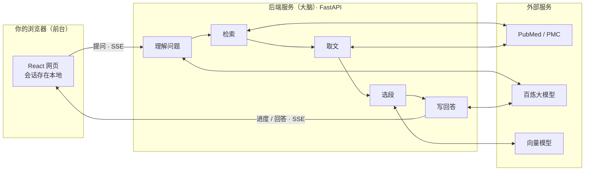
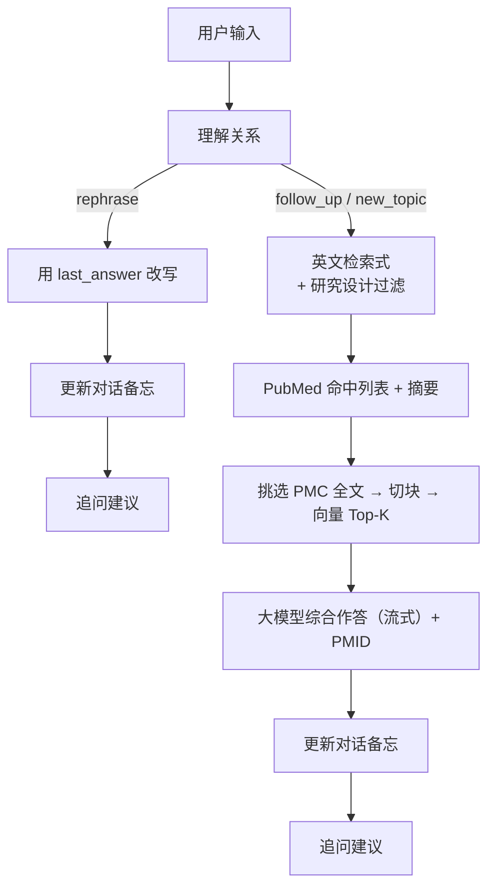

# MKB 产品文档

> 面向产品、临床、科研与运营同事的说明：讲清「这个系统是干什么的、怎么工作、为什么这样设计」，尽量少用术语；必要处用生活化比喻。
>
> 相关专项文档见文末「延伸阅读」。

---

## 1. 一句话是什么

**MKB（Medical Knowledge Base）是一个网页版医学文献问答助手。**

你用中文提问（例如「SGLT2 抑制剂对心衰住院有没有影响」），系统会：

1. 去全球最大的生物医学文献库 **PubMed** 检索相关论文；
2. 尽量拿到可免费阅读的全文，找不到就用摘要；
3. 挑出与问题最相关的段落；
4. 让大模型**只根据这些证据**写出中文回答，并标出引用的文献编号（PMID）。

它不是「凭记忆瞎聊」的通用聊天机器人，而是「先查文献、再综合」的循证问答工具。

**重要声明**：回答仅供科研与学习参考，**不能替代临床诊疗决策**。

---

## 2. 解决什么问题

| 传统做法 | 痛点 | MKB 怎么帮 |
| --- | --- | --- |
| 自己打开 PubMed 搜英文 | 不会写检索式、漏检、筛不过来 | 自动把中文问题改成英文检索式并检索约百篇 |
| 一篇篇点开摘要/全文 | 时间成本高 | 自动拉摘要，有开放全文再做段落级精读 |
| 问通用 AI | 可能编造文献、过时、无出处 | 强制基于本轮检索材料作答，并标注 `[PMID:…]` |
| 多轮追问时换工具 | 上下文断掉 | 支持追问、换题、改写；换题不会把旧病种带进新检索 |

**典型用户**：需要快速摸清某主题证据概况的临床医生、药学/科研人员、医学编辑、医学信息化产品同事。

**不适合**：需要正式系统综述、需要对单篇论文做完整批判性评价、需要访问付费全文库的场景（本系统只用法源开放获取全文）。

---

## 3. 产品能做什么（功能清单）

### 3.1 核心问答

- 中文提问 → 英文 PubMed 检索 → 综合回答（流式输出，边生成边显示）
- 回答中用 `[PMID:数字]` 标注证据来源；页面上可点击跳到文献
- 文献链接优先：**PMC 免费全文 → DOI → PubMed 页面**

### 3.2 多轮对话（三种关系）

系统会先判断你这句和上一轮是什么关系：

| 关系 | 含义 | 举例 | 系统行为 |
| --- | --- | --- | --- |
| **追问**（follow_up） | 同一主题，补细节或换人群 | 「那女性患者呢？」「副作用呢？」 | 消解指代后重新检索 |
| **换题**（new_topic） | 换了疾病/药物/主题 | 上一轮谈心衰，这轮问肺癌免疫治疗 | **不带入**旧主题重新检索 |
| **改写**（rephrase） | 只要缩短、翻译、换说法 | 「把上面缩短一点」「翻成英文」 | **不重新检索**，只改写上一轮完整回答 |

### 3.3 界面与体验

- **进度条**：问题分析 → 循证检索 → 证据整理 → 生成
- **文献列表**：期刊、年份、研究类型标签（指南 / Meta / 临床试验等）、中文标题翻译
- **证据段落**：展示本轮实际喂给模型的段落（全文或摘要），便于核对
- **追问建议**：回答结束后给出最多 3 个可点的后续问题
- **会话历史**：浏览器本地保存最近约 30 个对话；可新开对话、复制、导出 Markdown
- **停止生成**：可中途停止；已输出部分会尽量折进后续上下文

### 3.4 不做的事

- 不登录医院 HIS / 不读患者病历
- 不自动下单付费论文
- 不把撤稿文献当有效证据（会排除）
- 不保证「全库最全」——受开放全文覆盖率、检索策略与篇数上限影响

---

## 4. 整体架构（给非技术人员）

可以把 MKB 想成一家「医学图书馆 + 速记员 + 写手」的流水线：



### 4.1 三层分工

| 层 | 是什么 | 负责什么 | 类比 |
| --- | --- | --- | --- |
| **前端** | 网页（React + Vite） | 提问、展示进度与回答、点引用、管历史会话 | 图书馆前台与阅览桌 |
| **后端** | Python 服务（FastAPI） | 编排整条流水线、调用外部 API、流式回传事件 | 馆员按流程办事 |
| **外部依赖** | NCBI（PubMed/PMC）、阿里云百炼（对话模型 + 向量） | 真正的文献库与「读懂语义」的能力 | 书库与翻译/速记专家 |

### 4.2 为什么前后端分开

- 浏览器**不能**直接拿着密钥去刷 PubMed / 大模型（不安全，也容易超限）
- 检索与全文拉取较慢，适合在服务器跑；前端用「事件流」实时更新状态，用户不用干等一个大白屏

### 4.3 部署形态（生产）

线上常见结构：

- **Nginx**：对外提供网页，并把 `/api/` 转给后端；关闭缓冲以便流式回答实时显示
- **API 容器**：跑 Python 后端
- 默认对外端口见项目 README（公司机示例为 **9400**）

本地开发则是：前端开发服务器（如 6173）代理 `/api` → 后端（如 8000）。

---

## 5. 一次提问的完整流程（实现逻辑）

下面按时间顺序说明「点发送之后发生了什么」。对应界面上的四个阶段。

### 阶段 A：问题分析（understand）

**目的**：弄清你到底在问什么，以及要不要重新查文献。

1. 前端把「当前问题 + 对话上下文摘要」发给后端 `/api/ask`
2. 大模型返回结构化判断（JSON），主要包括：
   - **关系**：追问 / 换题 / 改写
   - **问题类型**：疗效、预防、诊断、预后、病因、机制、其他
   - **独立问题**（中文）：即使不看历史也能看懂的完整问句（例如把「那女性呢」补成「……在女性患者中的……」）
   - **检索式**（英文，1～3 条）：给 PubMed 用的查询串

**改写类**问题到此结束检索分支，直接进入「改写上一回答」。

否则继续：

3. 系统按问题类型**自动追加一条「研究设计过滤器」**（例如疗效问题更偏向系统综述、Meta、指南、RCT），提高高证据等级文献的占比。这条过滤器是系统拼的，不要求用户会写。

### 阶段 B：循证检索（search）

**目的**：从 PubMed 拉回一批相关文献元数据与摘要。

1. 用多条检索式分别搜索，合并去重，目标大约 **100 篇**（可配置）
2. 拉取每篇的标题、摘要、期刊、年份、作者、PMID、PMCID、DOI、文献类型等
3. 前端立刻收到文献列表，可先浏览「搜到了什么」

若一篇都搜不到，流程终止并提示换问法。

### 阶段 C：证据整理（fulltext + passages）

**目的**：尽量用「全文里真正相关的段落」作答，而不是整篇摘要硬塞给模型。

1. **选全文候选**：在有 PMCID（通常意味着可能有 PMC 开放全文）的文章里，按相关度优先，并预留少量名额给高证据等级文献（如 Meta、RCT），最多约 **10 篇**（可配置）
2. **拉取开放获取全文**（PMC）；去掉参考文献、致谢、脚注等噪音，并尽量剥离正文里的角标引用数字，避免干扰语义匹配
3. **排除撤稿**文献，不参与证据池
4. **切块（Chunk）**：按章节（引言/方法/结果/讨论）内的自然段拼成约千字一块，段间略有重叠；**不跨章节拼接**——像按章拆成索引卡片。没有章节信息时退回整篇段落拼装
5. **向量检索（RAG）**：
   - 用向量模型把「本轮独立问题」和每一段文字都变成数字向量
   - 算相似度，并按问题类型对章节略作加权（例如疗效类更偏向「结果」），选出最相关的约 **12 段**（可配置）
   - 限制同一篇文献贡献太多段落，避免答案被一篇文「霸屏」

**兜底策略**（保证系统尽量仍能答）：

| 情况 | 回退 |
| --- | --- |
| 没有开放全文 | 用摘要参与切块与检索 |
| 向量检索失败 | 直接用一批摘要拼给模型 |
| 既无全文也无摘要 | 仅依据标题等信息，并提示证据有限 |

### 阶段 D：生成回答（answer）

**目的**：基于本轮证据写出可读、可溯源的中文回答。

1. 大模型收到严格提示词：只能依据给定段落；关键结论标 `[PMID:…]`；证据冲突要说局限；末尾声明不能替代诊疗
2. **流式输出**：前端逐字/逐词显示
3. 更新「对话备忘」（见下一节），供下一轮追问用
4. 生成最多 3 条追问建议
5. 发送结束事件；前端可继续做标题中译等辅助请求

整条链路用 **SSE（服务器推送事件）** 把状态、文献、段落、正文片段推到浏览器，因此你能看到「正在检索…」「正在获取全文…」等进度。

---

## 6. 多轮对话是怎么「记住」的

系统**不**把整段聊天原文、全文证据长期堆在服务器上。后端是无状态的：每轮由前端带上一份精简的 **对话备忘**（技术字段名仍叫 context）。

备忘里大致只有：

| 字段 | 作用 |
| --- | --- |
| **summary** | 更早对话压缩成的中文摘要（疾病、药、人群、结论、PMID 等） |
| **recent** | 最近几轮的问题摘要 + 回答摘录 + 引用过的 PMID |
| **last_answer** | 上一轮完整回答（主要用于「缩短/翻译」类改写，不参与检索） |

设计意图：

- **追问**时能消解「这篇」「那女性」等指代
- **换题**时模型被要求不得把旧病种写进新检索式
- **改写**时不浪费一次全文检索，且禁止「偷偷补充上一轮没有的事实」
- 控制长度与成本，避免上下文无限膨胀

会话内容保存在**用户浏览器本地**（localStorage），上限约 30 个会话。换电脑或清缓存会看不到旧记录；服务端不替你存聊天档案。

刷新页面或点「新对话」会从空上下文开始（新会话）。

---

## 7. 证据质量相关设计（为什么答案相对靠谱）

这些规则大多写在后端提示词与检索策略里，用户无感但很关键：

1. **先检索后生成**：模型看不到「世界知识里的假 PMID」，只能用本轮材料
2. **按问题类型抬高证据等级**：疗效/预防偏 RCT 与综合类；诊断偏验证研究等
3. **全文优先、摘要兜底**：能读正文方法/结果时比只读摘要更稳
4. **撤稿剔除**：标为 Retracted Publication 的不进证据池；界面也会标「已撤稿」
5. **引用格式固定**：`[PMID:数字]`，前端可链接与编号展示
6. **改写不掺新证据**：明确提示「本轮未重新检索」
7. **追问建议贴题**：限制在本轮疾病/药物范围内，避免跳题

仍须注意：检索式不完美、开放全文不全、模型可能误读段落——**PMID 可点开原文核对**是产品设计的一部分，不是装饰。

---

## 8. 前端模块说明（用户能感知到的）

| 能力 | 用户看到的 | 背后思路 |
| --- | --- | --- |
| 示例问题 | 首页可点的常见临床问题 | 降低冷启动成本 |
| 四步进度 | 问题分析 / 循证检索 / 证据整理 / 生成 | 长等待时的透明感 |
| 引用点击 | 点 PMID 打开文献卡片/外链 | 溯源 |
| 文献类型标签 | 指南、Meta、临床试验、综述等 | 一眼判断证据形态 |
| 中文标题 | 英文题名旁的中译 | 降低阅读门槛（异步翻译，可与回答并行） |
| 复制 / 导出 MD | 带走回答与文献列表 | 写笔记、组会材料 |
| 停止按钮 | 中断生成 | 断线时后端也会停，避免空跑模型 |

技术栈一句话：React 单页应用，Markdown 渲染回答，开发时由 Vite 代理 API。

---

## 9. 后端模块说明（实现地图）

不必会读代码也能对照目录理解职责：

| 模块 | 职责（人话） |
| --- | --- |
| `main.py` | 对外接口：健康检查、提问（SSE）、标题翻译 |
| `pipeline.py` | **总导演**：理解问题 → 检索证据 → 流式作答 → 更新上下文 → 追问建议 |
| `pubmed.py` | 连 NCBI 搜文献、下摘要、识别撤稿、选全文候选 |
| `pmc.py` | 拉 PMC 开放全文、清洗正文 |
| `rag.py` | 切段、向量相似度、多样性挑选、拼证据文本 |
| `llm.py` | 调大模型对话与向量接口（OpenAI 兼容，当前常用百炼） |
| `titles.py` | 批量把英文标题译成中文 |
| `config.py` | 从环境变量读密钥与篇数/段落数等旋钮 |

### 对外 API（产品视角）

| 接口 | 作用 |
| --- | --- |
| `GET /api/health` | 服务是否正常、模型与 PubMed 是否配置齐全 |
| `POST /api/ask` | 主问答；返回一连串事件（状态、检索式、文献、段落、字词、上下文、建议、结束） |
| `POST /api/translate-titles` | 文献标题中译 |

### 可调「旋钮」（运维/产品可协商）

| 配置项 | 默认量级 | 调大 / 调小的影响 |
| --- | --- | --- |
| 检索文献上限 | ~100 | 更全但更慢、更贵 |
| 全文篇数上限 | ~10 | 证据更深但耗时与配额上升 |
| RAG 选用段落数 | ~12 | 回答更细但可能更噪、更费 token |
| 切块大小 / 重叠 | ~1000 / 150 | 章节内拼装；禁止跨章；影响段落粒度与召回 |

---

## 10. 数据流简图（追问 vs 改写）



---

## 11. 安全、隐私与合规边界（产品需知情）

- **密钥**：LLM、NCBI 等密钥只放在服务器环境变量中，不进前端代码仓库展示
- **对话内容**：默认存在用户本机浏览器；请勿在公共电脑保存敏感病例细节
- **外发数据**：问题与文献文本会发往配置的大模型服务商与 NCBI；上线前需符合单位数据外发规范
- **医学合规**：产品文案与模型提示均强调「非诊疗」；正式对外服务建议再加法务审阅的免责声明页

---

## 12. 已知局限与预期使用方式

1. **开放获取覆盖不全**：很多重要研究没有 PMC 全文，此时只能用摘要，细节可能不够
2. **检索式由模型生成**：偶发过宽/过窄；可在界面查看本轮检索式，必要时换说法重问
3. **不是系统综述流水线**：篇数有上限，不做人工纳入排除与偏倚评估
4. **模型仍可能误读**：务必点开 PMID 核对原文关键数据
5. **多轮靠摘要记忆**：极长对话早期细节可能被压缩掉；重要换题建议开「新对话」

**推荐用法**：把 MKB 当「快速摸证据地图 + 定位关键 PMID」的助手，再人工精读原文与指南。

---

## 13. 名词表（给非技术读者）

| 名词 | 解释 |
| --- | --- |
| **PubMed** | 美国国立医学图书馆维护的生物医学文献检索入口 |
| **PMID** | PubMed 给每篇文献的唯一数字编号 |
| **PMC / PMCID** | 开放获取全文库及编号；有 PMCID 才较容易自动拉全文 |
| **DOI** | 数字对象标识符，常用于跳到出版社页面 |
| **摘要 / 全文** | 摘要是短概要；全文含方法、结果等细节 |
| **检索式** | 交给 PubMed 的英文查询字符串（含 AND/OR 等） |
| **MeSH** | 医学主题词表，帮助用标准词命中同义说法 |
| **RAG** | 「检索增强生成」：先找相关段落，再让模型根据段落写回答 |
| **Embedding / 向量** | 把文字变成一串数字，便于计算「意思是否接近」 |
| **SSE / 流式** | 服务器边算边推送，页面可实时显示进度和文字 |
| **撤稿** | 正式撤回的论文，不可再当有效证据 |

---

## 14. 目录与职责对照（给要找人改需求的人）

```text
MKB/
├── frontend/          # 网页：提问、展示、本地历史
├── backend/app/       # 问答流水线与外部 API 调用
├── deploy/            # Nginx 等部署配置
├── scripts/           # 本地开发 / 一键部署脚本
├── docs/              # 产品与检索专项文档（你正在读的）
├── docker-compose.yml # 容器编排
└── README.md          # 启动与配置速查（偏技术）
```

---

## 15. 延伸阅读

| 文档 | 适合谁 | 内容 |
| --- | --- | --- |
| [../README.md](../README.md) | 开发 / 运维 | 环境变量、本地启动、部署命令 |
| [pubmed-检索式使用说明.md](./pubmed-检索式使用说明.md) | 会写检索、要审检索式的人 | PubMed 语法、过滤器、Advanced Search |
| [pubmed-skill-详细介绍.md](./pubmed-skill-详细介绍.md) | 临床/科研方法 | 证据分级、批判性评价、常见陷阱 |
| [2025中科院分区-pubmed未覆盖期刊.md](./2025中科院分区-pubmed未覆盖期刊.md) | 期刊覆盖分析 | 分区数据与 PubMed 覆盖差异 |

---

## 16. 版本说明

- 本文描述的是仓库当前实现的产品行为与模块职责（以 `backend/app/pipeline.py` 主流程与前端会话模型为准）。
- 具体默认数值（检索篇数、全文篇数、Top-K 等）以运行环境配置为准，可能与文中「约」值略有出入。
- 若产品行为与本文冲突，以线上实际界面与后端提示词/配置为准，并请同步更新本文。
